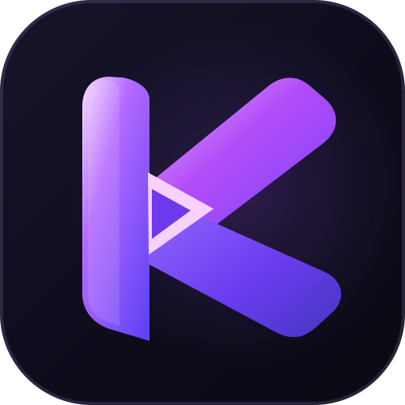

  
  <h1>🎬 Ma-Collection</h1>
  <h3>Collection française pour Nuvio</h3>
  
<strong>Créez un accueil Nuvio qui vous ressemble.</strong> 
  Parcourez les catalogues, choisissez vos catégories, organisez vos rangées et exportez votre collection depuis une interface en français.

  

    
    
    
  

  

    <a href="https://anderson76389.github.io/Ma-Collection/">🌐 Interface (après activation de GitHub Pages)</a> ·
    <a href="collections/">📁 Explorer les collections</a> ·
    <a href="https://github.com/ImKaptain/Kaptain-Collection">🛠️ Projet d'origine</a>
  

---

## ✨ Le projet

**Ma-Collection — Édition française** est une version adaptée du créateur de collections développé à l’origine par **[ImKaptain](https://github.com/ImKaptain/Kaptain-Collection)**.

Son objectif : rendre la **personnalisation des catalogues et de l'écran d'accueil de Nuvio** plus accessible, sans modifier manuellement des fichiers JSON de plusieurs milliers de lignes.

Vous pouvez sélectionner vos contenus préférés, réorganiser votre accueil et préparer une configuration à importer dans Nuvio. Les intitulés de l'interface, des catégories et des sous-catégories bénéficient d'une traduction française dédiée.

> **À savoir :** cet outil sert à **organiser et configurer des catalogues**. Il n'héberge pas de films ou de séries et ne fournit pas, à lui seul, de service de lecture vidéo.

## 🚀 Fonctionnalités

| | Fonction | Description |
|:--:|---|---|
| 🇫🇷 | **Interface française** | Navigation, menus, catégories et sous-catégories traduits. |
| 🎞️ | **Catalogues thématiques** | Sélections autour des genres, décennies, plateformes, chaînes, acteurs, réalisateurs, animés et bien plus. |
| 🎛️ | **Personnalisation** | Activez les dossiers et sources de votre choix, puis ajustez leur organisation. |
| 📺 | **Aperçu TV et mobile** | Visualisez la disposition de vos rangées avant l'export. |
| 🧭 | **Configuration guidée** | Un assistant facilite les étapes de sélection et de préparation. |
| ⚡ | **Éditeur rapide** | Modifiez votre sélection sans reprendre toute la configuration. |
| 📦 | **Export JSON** | Téléchargez un fichier de configuration réutilisable. |
| 🔗 | **Envoi vers Nuvio** | Envoyez votre sélection depuis le navigateur avec votre compte Nuvio, lorsque le service est accessible. |
| 👤 | **Gestion des profils** | Accédez aux outils d'organisation des profils existants. |

## 🗂️ Explorez les catégories

La bibliothèque couvre notamment :

| 🎬 Films et séries | 🌍 Découvertes | 🎭 Sélections |
|---|---|---|
| Genres | Cinéma international | Ambiances et émotions |
| Décennies | Documentaires | Acteurs |
| Animés | Télé-réalité | Réalisateurs |
| Collections de films | Plateformes de streaming | Récompenses |
| Tendances et nouveautés | Chaînes et studios | Basé sur… |

Les collections proviennent des fichiers du projet : leur présence ou leur disponibilité dans l'interface peut dépendre de la base chargée.

## 🧩 Comment l'utiliser ?

1. **Ouvrez l'interface** depuis le lien en haut de cette page.
2. **Choisissez votre méthode** : assistant de configuration ou éditeur rapide.
3. **Sélectionnez les catégories et sources** que vous souhaitez retrouver dans Nuvio.
4. **Ajustez l'ordre des rangées** et utilisez l'aperçu TV ou mobile.
5. **Téléchargez votre JSON** ou utilisez l'option **d'envoi direct vers Nuvio** si vous souhaitez connecter votre compte.

**Vous n'avez pas besoin de vous connecter à Nuvio pour préparer votre sélection et télécharger le fichier JSON.** La connexion est réservée aux fonctions qui accèdent à votre compte.

## 💻 Lancer le site en local

Le configurateur principal est une interface web. Pour éviter les restrictions du navigateur sur les fichiers locaux, servez le dossier avec un petit serveur HTTP.

~~~bash
git clone https://github.com/anderson76389/Ma-Collection.git
cd Ma-Collection
python -m http.server 8000
~~~

Ouvrez ensuite **http://localhost:8000** dans votre navigateur.

Cette commande nécessite Git et Python installés. Certaines fonctions spécialisées, notamment celles reposant sur **server.py**, peuvent nécessiter leurs propres dépendances : le serveur HTTP ci-dessus sert avant tout à ouvrir l'interface et à tester la sélection des catalogues.

## 🌐 Traduction française

Cette édition améliore particulièrement :

- **Les titres des catalogues**, catégories et sous-catégories.
- **Les traductions contextuelles** : cinéma international, documentaires, télé-réalité, genres, chaînes, plateformes, décennies et autres thématiques.
- **Les intitulés exportés** vers Nuvio, pour limiter le mélange de français et d'anglais.
- **Les noms propres et marques**, qui restent inchangés lorsqu'une traduction serait incorrecte.

La traduction porte sur les textes. **Les affiches, images, GIF, vidéos, identifiants des catalogues et liens vers les médias ne sont pas retravaillés pour la francisation.**

## 🔐 Connexion et données

- **Export local** : possibilité de préparer et télécharger la configuration sans connexion au compte Nuvio.
- **Envoi direct** : les fonctions liées au compte utilisent les API de Nuvio depuis le navigateur. Leur fonctionnement dépend de la disponibilité et de l'évolution de ce service.
- **Sauvegarde optionnelle** : le projet contient aussi un mécanisme de stockage local protégé par phrase secrète. Une synchronisation cloud séparée nécessite une configuration supplémentaire ; elle n'est pas activée par défaut.

Pour tout usage impliquant un compte, vérifiez l'adresse du site et évitez de transmettre vos identifiants à un tiers.

## 🧱 Organisation du dépôt

| Chemin | Rôle |
|---|---|
| [index.html](index.html) | Point d'entrée de l'interface |
| [app.js](app.js) | Logique principale et gestion des collections |
| [wizard.js](wizard.js) | Assistant de configuration |
| [profile-studio.js](profile-studio.js) | Outils de gestion des profils |
| [nuvio-push.js](nuvio-push.js) | Intégration des fonctions d'envoi vers Nuvio |
| [collections/](collections/) | Données des catalogues et sélections |
| [locales/fr.json](locales/fr.json) | Traductions françaises des catalogues |
| [locales/site-fr.json](locales/site-fr.json) | Traductions françaises de l'interface |
| [site-fr.js](site-fr.js) | Application des traductions dans la page |
| [assets/](assets/) | Ressources visuelles existantes |

## ❓ Questions fréquentes

<strong>Faut-il un compte Nuvio ?</strong>

Non pour composer une collection et exporter le JSON. Oui pour les fonctions qui interagissent directement avec votre profil Nuvio.

<strong>Le site héberge-t-il les films ou les séries ?</strong>

Non. Il construit et organise des catalogues et des configurations. Il ne remplace pas un service de contenu ou de lecture.

<strong>Pourquoi certains noms restent-ils en anglais ?</strong>

Les marques, titres officiels et noms propres ne doivent pas être traduits artificiellement. Les données de catalogue et les libellés visibles peuvent également provenir de sources différentes.

<strong>L'envoi direct vers Nuvio est-il garanti ?</strong>

Non. Il dépend des API et de la disponibilité de Nuvio. L'export JSON permet de conserver une copie de la configuration indépendamment de cette connexion.

## 🤝 Crédits et indépendance

Ce dépôt est une **copie GitHub indépendante** issue d'une adaptation de [ImKaptain/Kaptain-Collection](https://github.com/ImKaptain/Kaptain-Collection). Il ne fait pas partie du réseau de forks GitHub du projet d'origine. Le travail initial de conception, les fonctionnalités historiques et les ressources associées restent attribués à leurs auteurs respectifs.

Cette édition apporte notamment des **corrections et adaptations françaises**. Elle n'est **ni officielle ni affiliée à Nuvio**.

Aucune licence explicite n'est actuellement déclarée dans ce dépôt : sa visibilité publique ne vaut pas automatiquement autorisation de réutiliser ou redistribuer tous ses éléments.

---

  
<strong>🎬 Votre collection. Vos catégories. Votre accueil Nuvio.</strong>

  
<a href="#haut">Retour en haut ↑</a>

## ✍️ Harmonisation des intitulés français

Tous les titres visibles de la collection sont normalisés : l'esperluette `&` devient **`Et`** dans les catégories, sous-catégories, rangées, descriptions et exports. Les noms reconnus par les traductions françaises continuent à être traduits intégralement : les anciennes formes servent uniquement de clés de compatibilité. Le contrôleur `node scripts/normalize-ampersands.mjs --check` prévient toute régression. Cette transformation **ne touche jamais** aux URLs, requêtes, identifiants TMDB/Trakt, filtres, images, GIF ou vidéos.

## 🇫🇷 Importation Nuvio entièrement en français

**[Télécharger la collection complète française (JSON)](export/nuvio-collection-fr.json)** · [Lien direct hébergé sur GitHub Pages](https://anderson76389.github.io/Ma-Collection/export/nuvio-collection-fr.json)

Tous les **titres de catégories, dossiers et sous-catégories** sont localisés dans les champs utilisés par Nuvio (`title`, `name`, `genre`), y compris pour un export sans personnalisation et un envoi direct au profil. Les **noms officiels de chaînes, marques, noms propres**, IDs TMDB/Trakt, filtres, images, GIF et vidéos restent inchangés.

L'export automatique couvre les **20 fichiers de collections** ; il fusionne les sections partageant réellement les mêmes identifiants Nuvio pour éviter les doublons. Lors du dernier contrôle, cela représentait **18 catégories Nuvio distinctes, 756 dossiers et 3 648 sources uniques**. Un audit empêche la publication si des traductions manquent. Le fichier est régénéré chaque semaine.

**Important :** si vous aviez déjà importé une collection anglaise dans Nuvio, elle ne se traduit **pas rétroactivement**. Il faut **réimporter ce JSON** ou **réenvoyer la collection depuis le site vers le profil Nuvio concerné** ; les anciens catalogues présents dans le profil ne sont pas modifiés automatiquement.

## 🔄 Nouveautés et sélections dynamiques

Les rangées **Nouveaux films, Nouvelles séries, sorties récentes et nouveaux animés** utilisent des fenêtres de dates glissantes, recalculées chaque lundi. Un audit des catalogues individuels confirme **377 sources hebdomadaires** couvrant les **22 plateformes**, **68 chaînes**, **6 dossiers de télé-réalité**, ainsi que les genres, films, séries, animés, documentaires et autres nouveautés. **1 708 sources TMDB Discover supplémentaires** récupèrent leurs classements en direct. Les années historiques, récompenses, listes de tiers, affiches et GIF restent préservés. Les classements tiers ne sont pas garantis hebdomadaires et les nouvelles bornes de dates d'une configuration déjà importée dans Nuvio peuvent nécessiter une réimportation. [Détail, contrôle et limites](docs/CATALOGUES_DYNAMIQUES.md).

## 🇫🇷 Moteur de catalogues FR indépendant

Un **moteur hebdomadaire complémentaire** prépare des catalogues en France à partir de TMDB : plateformes disponibles dans la région FR, chaînes, télé-réalité, animés, sorties récentes, épisodes et saisons. Il surveille également un **échantillon** de disponibilités pour signaler des changements possibles et intègre les **Top 10 Netflix France officiels uniquement lorsqu'ils sont validés**.

**Activation nécessaire :** ajouter votre secret GitHub Actions `TMDB_API_KEY`, puis lancer le workflow `Moteur FR Ma-Collection`. La génération publiera alors des fichiers JSON Stremio distincts des collections historiques ; elle ne réécrit aucune liste fixe, aucun média ni aucun profil Nuvio. La compatibilité avec votre version de Nuvio doit être testée après installation de l'addon.

**[Documentation complète, activation et limites du moteur France](docs/MOTEUR_FR.md)**

## 📅 Top 10 Netflix France — actualisation hebdomadaire

Une automatisation fondée sur les [classements hebdomadaires officiels Netflix](https://www.netflix.com/tudum/top10) est préparée pour archiver les Top 10 français. **Les listes historiques ne sont pas modifiées** ; l'affichage automatique dans Nuvio demande une configuration de deux listes TMDB personnelles. [Voir le guide de configuration et les sécurités](docs/NETFLIX_FR_AUTO.md).

## 📌 Origine et dépendances

Ce dépôt reprend une adaptation de [Kaptain Collection](https://github.com/ImKaptain/Kaptain-Collection). L'attribution au projet d'origine est conservée ; la mise en ligne publique des éléments tiers doit respecter leurs droits d'auteur et leurs licences applicables. Certaines listes TMDB/Trakt, images et ressources visuelles externes peuvent encore dépendre de leurs propriétaires. La migration du dépôt ne garantit donc pas l'autonomie des catalogues.
